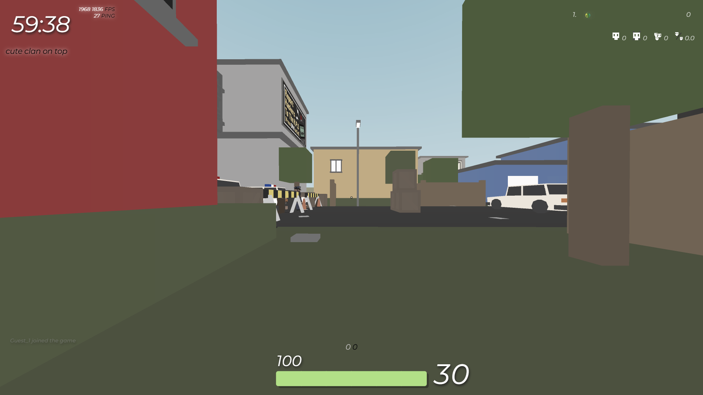

<h1 align="center">KSS</h1>

  

  KSS (Kute Style System) is a community-driven collection of custom CSS for Krunker, designed to integrate with <a href="https://github.com/NullDev/Kute">Kute client</a>.

<h2 align="center"><a href="39e_css/39e_css.css">39e css</a></h2>

By reizu & rinkishimo

<h2 align="center"><a href="Arkham/Arkham.css">Arkham</a></h2>

By -deusVult

<h2 align="center"><a href="ausp/ausp.css">ausp</a></h2>

By Unknown

<h2 align="center"><a href="Bipolar/Bipolar.css">Bipolar</a></h2>

By Unknown

<h2 align="center"><a href="BlackLune/BlackLune.css">BlackLune</a></h2>

By Unknown & Skal

<h2 align="center"><a href="Brutal/Brutal.css">Brutal</a></h2>

By -deusVult

<h2 align="center"><a href="ComfyNord/ComfyNord.css">Comfy Nord</a></h2>

By iona

<h2 align="center"><a href="Cookies_CSS/Cookies_CSS.css">Cookies CSS</a></h2>

By Unknown

<h2 align="center"><a href="EXTRA_CLEAN_v3/EXTRA_CLEAN_v3.css">EXTRA CLEAN v3</a></h2>

By thaddeuz

<h2 align="center"><a href="Glass_v1/Glass_v1.css">Glass v1</a></h2>

By -deusVult

<h2 align="center"><a href="gr2n/gr2n.css">gr2n</a></h2>

By Unknown

<h2 align="center"><a href="lemonfish-hud/lemonfish-hud.css">LEMONFISH CSS - IN-GAME HUD ONLY</a></h2>

By tae

<h2 align="center"><a href="mof1/mof1.css">mof1</a></h2>

By epicX67

<h2 align="center"><a href="MTZ/MTZ.css">MTZ CSS</a></h2>

By AirFxrce

<h2 align="center"><a href="NeonBar/NeonBar.css">NeonBar</a></h2>

By NamekujiLSDs & JINXZ

<h2 align="center"><a href="NeonStorm/NeonStorm.css">NeonStorm</a></h2>

By NamekujiLSDs & JINXZ

<h2 align="center"><a href="Nuke/Nuke.css">Nuke</a></h2>

By Unknown

<h2 align="center"><a href="Nuke_default/Nuke_default.css">Nuke_default</a></h2>

By Qwest500 & AnimeGirl47

<h2 align="center"><a href="Nuke_reimagined/Nuke_reimagined.css">Nuke Reimagined</a></h2>

By Skal & Liamoule

<h2 align="center"><a href="Old_Panda/Old_Panda.css">Old_Panda</a></h2>

By Unknown

<h2 align="center"><a href="Omori/Omori.css">Omori</a></h2>

By Unknown

<h2 align="center"><a href="Pandarium/Pandarium.css">Pandarium</a></h2>

By Unknown

<h2 align="center"><a href="Skals/Skals.css">Skals</a></h2>

By Unknown

<h2 align="center"><a href="tae_og_2018_css/tae_og_2018_css.css">Krunker Classic</a></h2>

By Tae & Rinkishimo

<h2 align="center"><a href="titanboi_old/titanboi_old.css">titanboi_old</a></h2>

By Unknown

<h2 align="center"><a href="uwu_quake/uwu_quake.css">uwu quake css</a></h2>

By reizu & rinkishimo

<h2 align="center"><a href="V7oid/V7oid.css">V7oid</a></h2>

By Unknown

<h2 align="center"><a href="Vi5la/Vi5la.css">Vi5la</a></h2>

By Unknown

<h2 align="center"><a href="water2noname/water2noname.css">water2noname</a></h2>

By sealfr0

<h2 align="center"><a href="xeno_xenon_old1/xeno_xenon_old1.css">xeno_xenon_old1</a></h2>

By DEADCELL & XenoXenon

<h2 align="center"><a href="xeno_xenon_old2/xeno_xenon_old2.css">xeno_xenon_old2</a></h2>

By DEADCELL

<h2 align="center"><a href="Yoko_1/Yoko_1.css">Yoko_1</a></h2>

By Unknown

<h2 align="center"><a href="zTest/zTest.css">zTest</a></h2>

By Unknown

  Made for <a href="https://github.com/NullDev/Kute">Kute</a> and the Krunker community.

