<h1 align="center">Kute CSS Store</h1>

  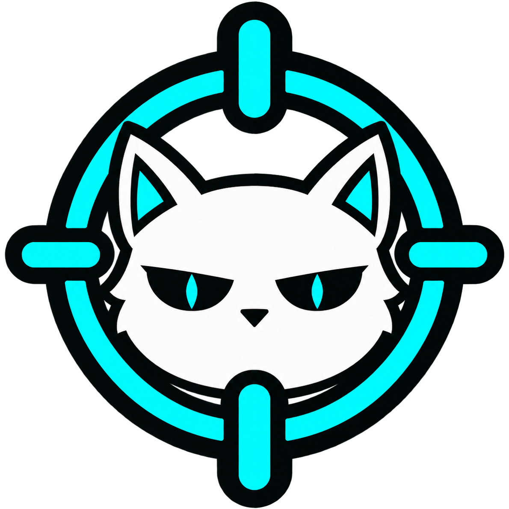

  A collection of custom CSS for Krunker made by the community, browsable and downloadable from the CSS Manager in <a href="https://github.com/NullDev/Kute">Kute</a>.

## Ownership and licensing

Every theme in this repository belongs to its author(s). None of them are licensed by Kute, and this repository has no license of its own that would cover them. Kute only collects them so players can find and download them in one place, and credits every author it knows below.

Themes that state a license (for example GPL-3.0) keep it, and that license applies to that theme only. Where a theme says nothing, all rights stay with its author.

## Are you an author?

If one of these is your CSS and you want it **removed**, **credited differently**, or **linked to your own page**, [open an issue](https://github.com/kute-client/kute-css-store/issues/new) and say which theme it is, or reach us on the [Kute Discord](https://discord.com/invite/MUJbP3fXrS). Removal requests are handled as fast as we can, no questions asked.

If you know who made one of the themes marked "Unknown", please tell us too, so they get the credit.

## Submitting a theme

Open a pull request that adds a folder with your `.css` file, an entry in `index.json`, and optionally a `preview_1.png`. By submitting you confirm that you made the CSS (or have the author's permission) and that Kute may distribute it in the CSS Store.

## Themes and sources

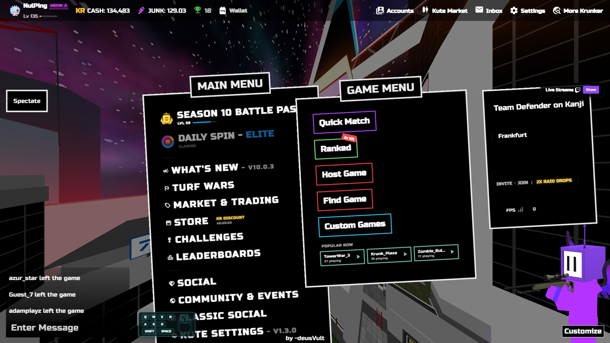

<h3 align="center"><a href="Arkham/Arkham.css">Arkham</a></h3>

By -deusVult

<b>Source:</b> <a href="https://github.com/deusVult69/krunker-css-arkham">deusVult69/krunker-css-arkham</a> <b>License:</b> none stated

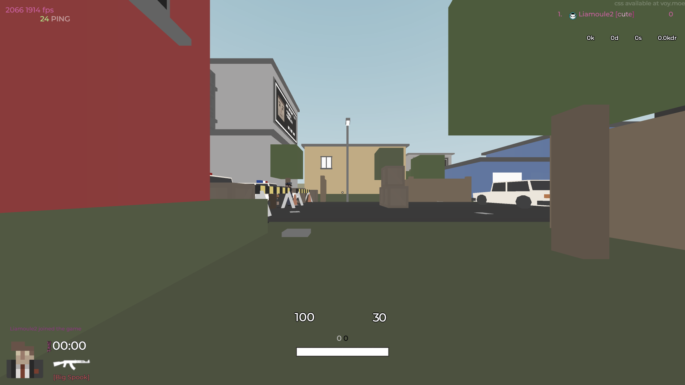

<h3 align="center"><a href="ephemeral/ephemeral.css">ephemeral</a></h3>

By ashevoy

<b>Source:</b> <a href="https://voy.moe/">ashevoy's website</a> <b>License:</b> none stated

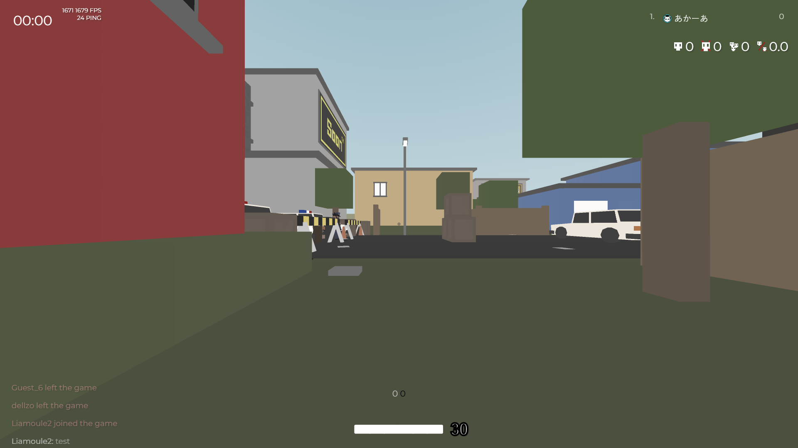

<h3 align="center"><a href="EXTRA_CLEAN_v3/EXTRA_CLEAN_v3.css">EXTRA CLEAN v3</a></h3>

By thaddeuz

<b>Source:</b> <a href="https://www.youtube.com/@thaddeuz_">youtube.com/@thaddeuz_</a> <b>License:</b> redistribution with credit, per the author's note in the file

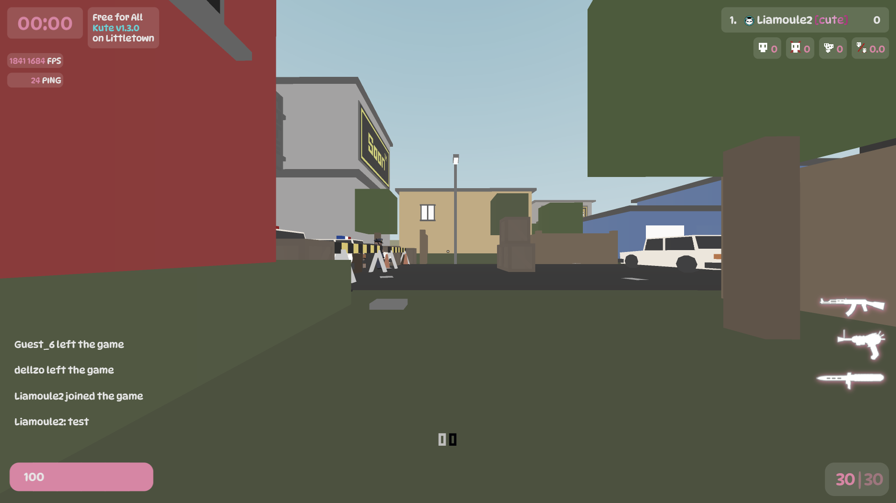

<h3 align="center"><a href="Glass_v1/Glass_v1.css">Glass v1</a></h3>

By -deusVult

<b>Source:</b> <a href="https://github.com/deusVult69/krunker-glass-css">deusVult69/krunker-glass-css</a> <b>License:</b> none stated

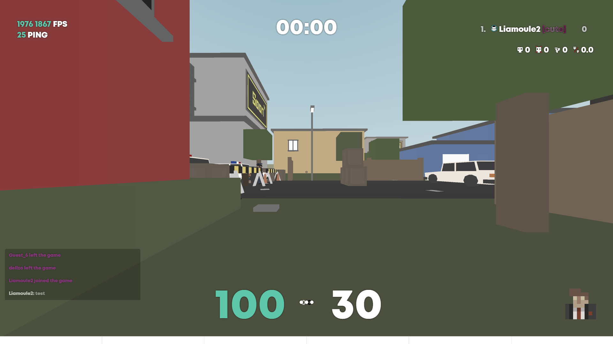

<h3 align="center"><a href="lemonfish-hud/lemonfish-hud.css">Lemonfish (HUD only)</a></h3>

By tae (<code>whuuayu</code>), trimmed to the in-game HUD

<b>Source:</b> <a href="https://github.com/whuuayu/lemonfish-css">whuuayu/lemonfish-css</a> <b>License:</b> <a href="lemonfish-hud/LICENSE">GPL-3.0</a>

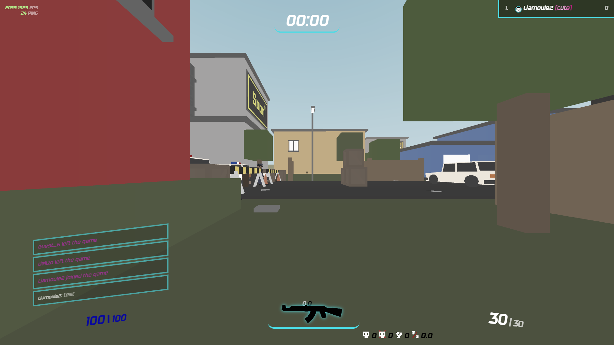

<h3 align="center"><a href="NeonBar/NeonBar.css">NeonBar</a></h3>

By NamekujiLSDs (original), rewritten by JINXZ

<b>Source:</b> Discord <b>License:</b> none stated

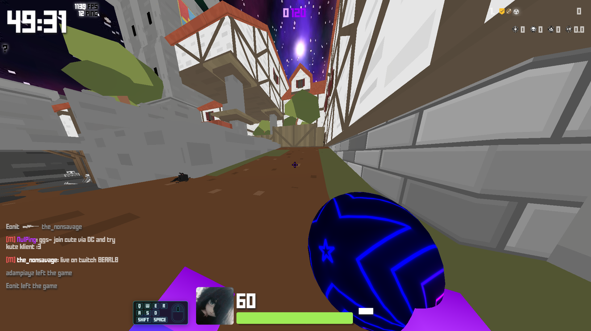

<h3 align="center"><a href="Nuke/Nuke.css">Nuke</a></h3>

By Skal ("Skal Dark")

<b>Source:</b> <a href="https://github.com/CoderZ90/sleepclient-api/blob/main/css/skalDark.css">sleepclient-api</a> <b>License:</b> none stated

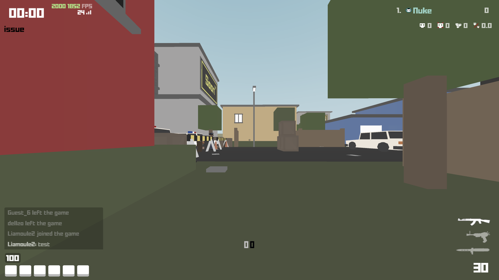

<h3 align="center"><a href="Nuke_default/Nuke_default.css">Nuke_default</a></h3>

By Qwest500, AnimeGirl47

<b>Source:</b> <a href="https://www.reddit.com/r/KrunkerIO/comments/14omg1u/finished_mostly_the_css_remake/">r/KrunkerIO</a> <b>License:</b> none stated

<h3 align="center"><a href="Nuke_reimagined/Nuke_reimagined.css">Nuke_reimagined</a></h3>

By Skal, Liamoule (based on Skal Dark)

<b>Source:</b> this repository <b>License:</b> none stated

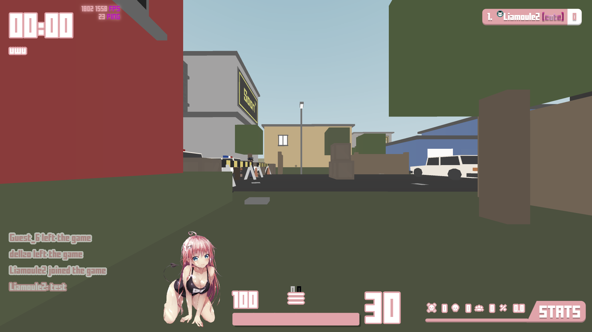

<h3 align="center"><a href="Skals/Skals.css">Skals</a></h3>

By Skal

<b>Source:</b> Discord <b>License:</b> none stated

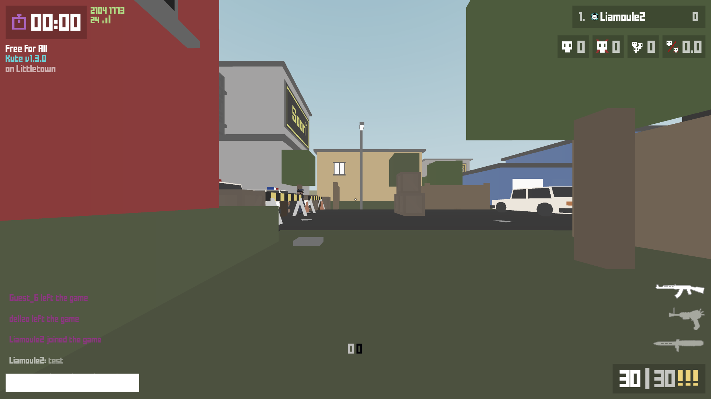

<h3 align="center"><a href="tae_og_2018_css/tae_og_2018_css.css">Krunker Classic</a></h3>

By tae (<code>whuuayu</code>), 2026 fixes by Rinkishimo

<b>Source:</b> <a href="https://github.com/whuuayu/krunker-classic-css">whuuayu/krunker-classic-css</a> <b>License:</b> none stated

Fonts and images that a theme loads from other sites belong to their respective owners.

  Made for <a href="https://github.com/NullDev/Kute">Kute</a> and the Krunker community.

